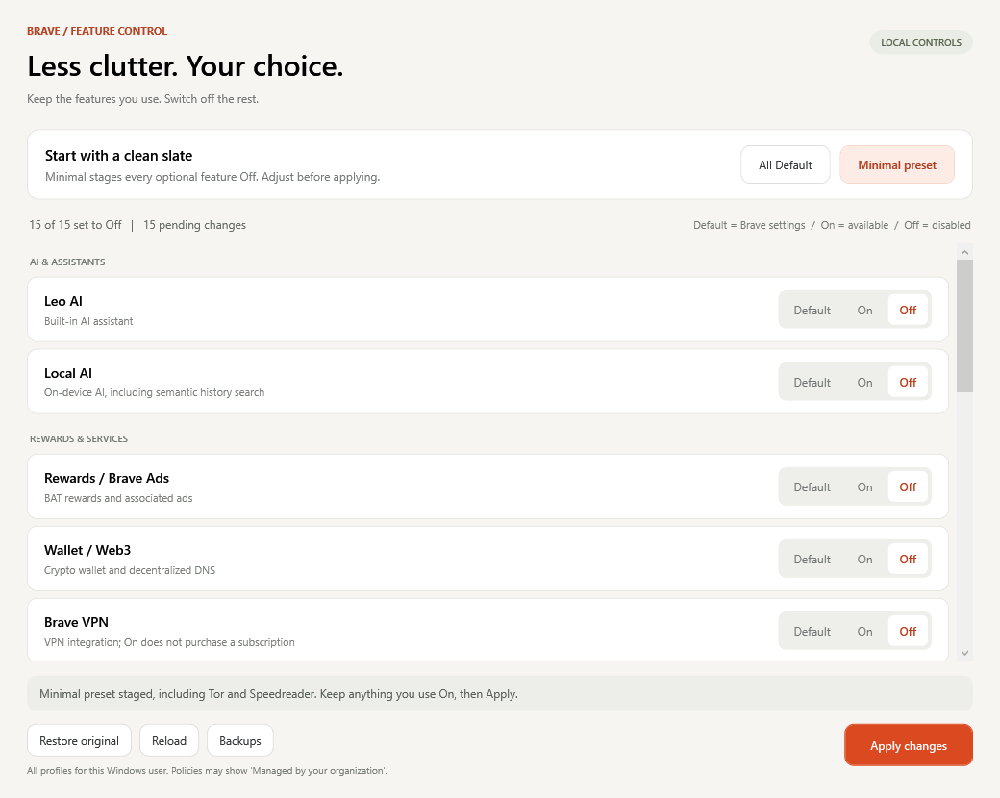

# Brave Feature Control for Windows

A native Windows control panel for turning optional Brave features on or off, with reversible policies and automatic backups.



Download the ZIP from [Releases](https://github.com/scuba3198/brave-feature-control/releases/latest), extract it, and run the launcher. Alternatively, download or clone this repository.

Version 2 uses a redesigned native Windows panel with grouped feature cards, segmented Default/On/Off controls, a pending-change counter, and a highlighted Apply button. It uses Windows' built-in WPF libraries.

Keep `Open-Brave-Feature-Control.cmd` and `Brave-Feature-Control.ps1` together. Double-click the `.cmd` file to open the panel. No installation is required. If Windows protects the Brave policy registry key, the script requests administrator access through a Windows UAC prompt before opening the panel. Use the same Windows account; elevation to a different account is refused to avoid changing the wrong user's policies. The launcher uses a process-only execution policy bypass; it does not change Windows execution policy.

1. Choose **Minimal preset** to stage all optional features Off, or change individual choices.
2. Keep features such as Tor or Speedreader On if you use them.
3. Click **Apply**. Fully exit Brave, including background processes, and reopen it when convenient. The tool does not terminate Brave.
4. Open `brave://policy`, click **Reload policies**, and check that your chosen policies have status **OK**. Unknown or ignored policies do not take effect.

If the previous version reported `CreateSubKey: Access ... is denied`, close it, extract this updated package, and launch it again. Approve the Windows UAC prompt. The script checks write access without creating keys before requesting elevation, and checks again before saving an apply journal or writing policies. It never changes registry permissions. The old failure normally restored the previous values; the updated version keeps the same backup location.

**Off** disables the feature through a policy. **On** permits the feature; it does not enroll you in Rewards, enable data collection consent, purchase VPN, or complete setup. **Default** removes the user policy so Brave's saved preferences and defaults decide. **Restore original** restores only values changed by this tool to their state before your first change. Apply or restore refuses to overwrite a tracked value changed outside this tool.

Supported controls: Leo AI, local AI, Rewards/ads, Wallet/Web3, VPN, News, Talk, Tor windows, Playlist, Speedreader, Wayback Machine, Web Discovery, P3A analytics, daily usage ping, and email aliases. Names were checked against Brave 1.96.61 source. Some build-dependent features may be unavailable even with On selected.

Policies are stored in `HKEY_CURRENT_USER\Software\Policies\BraveSoftware\Brave`. They affect all Brave profiles for your Windows user. Machine-level policies are left untouched and locked in the panel. Brave may display **Managed by your organization** because you set local policies. This is an Origin-like feature control panel, not an Origin license or replacement browser build. Feature code remains installed, so it does not promise Origin's build size or performance.

The tool does not edit browser profile files, bookmarks, passwords, Shields, Sync, extensions, or update settings. The presets do not disable ordinary private browsing. Backups and the restore journal live in `%LOCALAPPDATA%\BraveFeatureControl`. Keep that folder to retain restoration. On an interrupted write, a conflict can require inspecting `restore.json` and `before-*.json` before manually restoring the affected policy values.

For a quieter new-tab page, use its **Customize** panel to hide sponsored backgrounds and cards. For crash reporting, go to **Settings > Privacy and security > Data Collection**. These preferences are not controlled by this script.

Read-only policy report:

```powershell
powershell.exe -NoProfile -ExecutionPolicy Bypass -File .\Brave-Feature-Control.ps1 -Mode Status
```

Sources:
- [Brave policy documentation](https://support.brave.app/hc/en-us/articles/360039248271-Group-Policy)
- [Brave feature hiding and disabling guide](https://support.brave.app/hc/en-us/articles/38305898674957-How-do-I-hide-or-disable-features-in-Brave)
- [Brave 1.96.61 policy mappings](https://github.com/brave/brave-core/blob/v1.96.61/browser/policy/brave_simple_policy_map.h)

Validation: WPF construction and both preset checks, a rendered layout inspection, and apply/default/restore, external-change conflict, rollback, and permission-preflight tests against an isolated test registry key. The policy-access check was also verified on a Windows account with read-only policy permissions. The elevated write still needs to be confirmed after you accept Windows' UAC prompt and Apply. Always confirm the resulting policies in your installed Brave version. Browser behavior must be confirmed using `brave://policy` after Apply.

## Run the checks

The registry tests use a unique temporary key under the current user and remove it afterward. They do not change Brave policies.

```powershell
powershell.exe -NoProfile -ExecutionPolicy Bypass -File .\tests\Test-Brave-Feature-Control.ps1
powershell.exe -NoProfile -STA -ExecutionPolicy Bypass -File .\Brave-Feature-Control.ps1 -Mode VerifyUI
```
